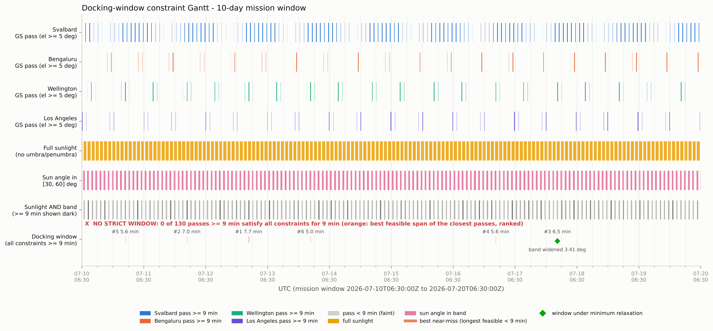
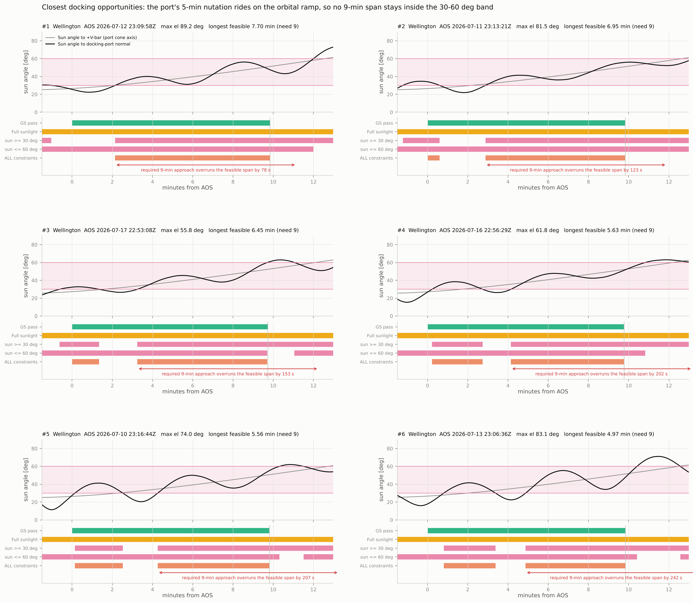
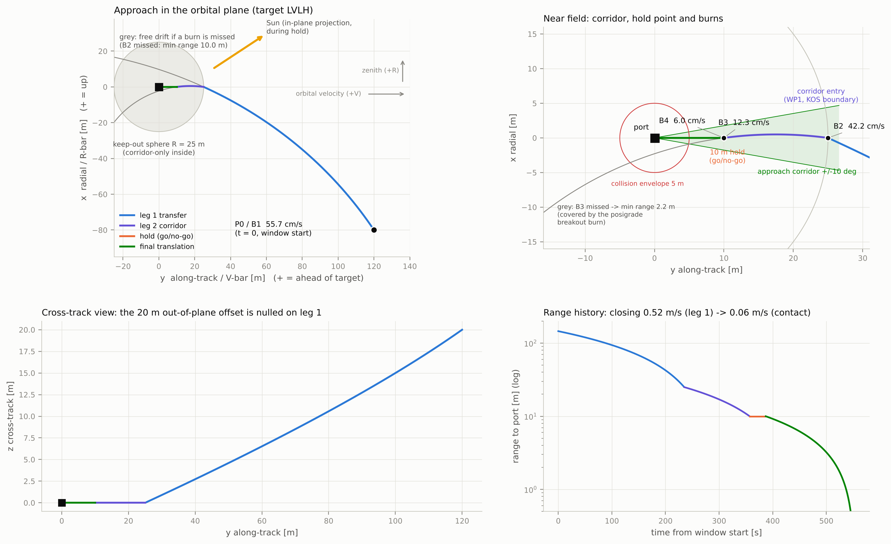
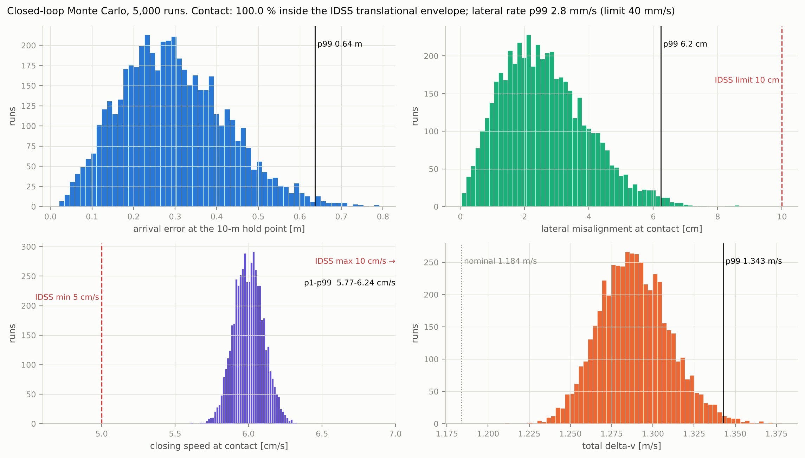
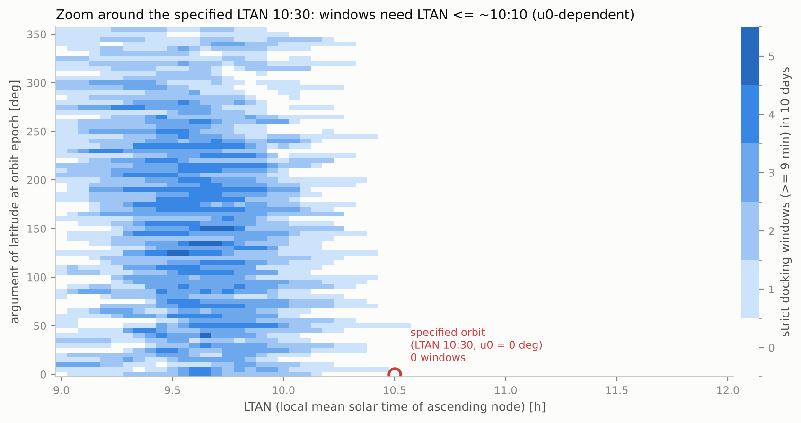

# Aule RPOD — Docking-Window Analysis and Terminal-Approach Design

**A reproducible astrodynamics study of rendezvous, proximity operations and docking (RPOD).** It searches for a docking opportunity that satisfies orbit geometry, ground-station visibility, eclipse and solar-illumination constraints; explains when the constraints conflict; and designs a conditional terminal approach when the smallest tested relaxation makes a window available.

> **The central result:** Under the baseline mission constraints, the 10-day search finds **zero valid 9-minute docking windows**. The longest strictly feasible span is **462.1 s**, which is **77.9 s short** of the required 540 s. Widening the solar-port-angle band by a minimum **3.41°** creates a **583.9 s candidate window** at Wellington on **17 July 2026**. A +V-bar approach is then designed for that *relaxed* window; it is not a solution under the original strict constraints.

This is an assumption-driven mission-analysis project, **not flight software and not flight-qualified guidance**. The report records both the model choices and the limitations that would need to be resolved before any operational use.

## Results at a glance

| Question | Result from the committed analysis |
|---|---|
| Does the baseline 10-day mission contain a valid docking window? | **No — 0 strict windows** |
| What is the best strict candidate? | Wellington; **462.1 s** feasible span versus **540 s** required |
| What blocks it? | Solar-port-angle constraint at the start; ground-station pass ends before a full 9-minute span is available |
| What is the minimum tested uniform relaxation that opens a window? | Widen the illumination band by **3.41°**, keeping the other constraints hard |
| First window under that relaxation | **2026-07-17 22:53:08 UTC**, Wellington; **583.9 s** available |
| Selected terminal approach for that window | **+V-bar**, 25 m corridor-entry point, 10 m hold, 6 cm/s final translation |
| Nominal modeled delta-v | **1.184 m/s** total, including continuous final-translation compensation |
| Nominal contact timing | **553.7 s** after window opening, with **30.3 s** remaining in the candidate window |
| Closed-loop dispersion study | **5,000 seeded Monte Carlo runs**; every modeled contact remains within the translational envelope used by the analysis |

The Part II results are **conditional on the 3.41° relaxation**. The original constraints remain infeasible in this model.

## See the analysis

### 1. Window search and near-miss diagnosis



The pipeline keeps the constraints separate, finds their event times, intersects the resulting feasible intervals, and preserves per-candidate diagnostics. The result is not just “no window”: it identifies which constraint prevents the best candidate from reaching 540 seconds.



### 2. Approach design and robustness



The selected +V-bar plan uses Clohessy–Wiltshire targeting for the nominal maneuver sequence, missed-burn/passive-safety analysis, mid-course-correction slots, and a closed-loop final translation model. A separate nonlinear J2 propagation checks the planned trajectory against a higher-fidelity relative-motion model.



### 3. Sensitivity of feasibility to mission assumptions



A sensitivity campaign sweeps orbit phase and local time of the ascending node (LTAN), and tests alternative readings of underspecified mission details. This matters because a window that appears or disappears under a convention change should be treated as a specification question—not silently accepted as a numerical result.

## What the pipeline does

1. **Reconstruct the scenario.** A validated `config/mission.yaml` is the single source for the orbit, attitude input, stations, constraints, numerical tolerances and explicitly marked assumptions.
2. **Propagate the geometry.** Model the sun-synchronous target orbit with secular J2; use consistent time scales and Earth orientation; compute Sun direction, LVLH geometry, station look angles and Earth-shadow intersections.
3. **Recover the target attitude law.** Read the STK attitude file, test quaternion conventions, and identify the closed-form precession/nutation law against all 14,401 samples.
4. **Solve continuous constraints.** Convert each constraint to a signed function, bracket/refine its events, then apply interval algebra to combine ground visibility, eclipse exclusion, illumination band and the 540 s duration requirement.
5. **Explain infeasibility.** Rank near-miss passes, quantify the deficit, sweep orbit phase/LTAN, test alternative interpretations and compute the minimum uniform illumination-band relaxation.
6. **Design a conditional approach.** Compare approach axes; build a CW maneuver plan; evaluate camera/Sun geometry, keep-out-zone passage, missed-burn behavior, plume exposure, Monte Carlo dispersions and nonlinear J2 trajectory errors.
7. **Validate independently.** Cross-check against Astropy/ERFA, JPL DE421 and Orekit 13, and write structured CSV/JSON products plus a run manifest.

## Verification evidence

The committed `outputs/validation/validation_report.md`, `outputs/run_log.txt` and `outputs/run_manifest.json` record these results for the generated run:

| Check | Recorded result |
|---|---|
| Attitude-law identification | Maximum residual **2.2 × 10⁻¹¹ rad** across 14,401 input samples |
| Sun direction | ERFA versus JPL DE421 difference of **0.01 arcsec** |
| GCRS → ITRS / station geometry | Position difference **2 cm**; elevation difference about **5 × 10⁻⁷°** against independent references |
| Event-finder grid sensitivity | Results agree within **0.7 ms** for 1 s, 2 s and 5 s grids |
| Independent end-to-end check | Longest feasible candidate span agrees with the independent Astropy chain within **0.71 s** |
| Orekit 13 propagation / visibility / eclipse | Position difference **1.9 cm over 20 days**; AOS/LOS within **0.91 ms**; penumbra boundaries within **13.8 ms** |
| Nonlinear J2 check of the approach | Relative trajectory deviation no greater than about **5.1 cm** at evaluated waypoints and contact |
| Built-in self-test | The recorded run reports **9 checks passed** |

These are results of the **recorded configuration and run**, not blanket accuracy guarantees for other scenarios. The source includes a pytest suite and a built-in self-test; rerun them in your own environment before relying on a fresh code change.

## Quick start

Python **3.10 or newer** is required. The commands below are for Windows PowerShell first.

### Windows PowerShell

```powershell
# Run from the repository root
py -3.10 -m venv .venv
.\.venv\Scripts\Activate.ps1
python -m pip install --upgrade pip
python -m pip install -e ".[dev]"

# Basic checks
python -m pytest
aule-rpod selftest
```

If PowerShell blocks virtual-environment activation, allow it for this terminal session only, then activate again:

```powershell
Set-ExecutionPolicy -Scope Process -ExecutionPolicy Bypass
.\.venv\Scripts\Activate.ps1
```

### Linux / macOS

```bash
python3 -m venv .venv
source .venv/bin/activate
python -m pip install --upgrade pip
python -m pip install -e ".[dev]"
python -m pytest
aule-rpod selftest
```

### Run individual analysis stages

```powershell
aule-rpod part1             # docking windows, constraint logs and Part I products
aule-rpod part2             # nominal approach plan for the selected relaxed window
aule-rpod studies --quick   # quick sensitivity/interpretation study
```

The full study and independent-validation paths require additional runtime and data. The repository's `Makefile` documents the intended reproducibility workflow on systems with `make` available:

```bash
make install
make test
make selftest
make all
make report
```

For the Orekit/DE421 validation data setup, see `scripts/build_orekit_data.py`, `scripts/fetch_de421.py` and the validation section of the report. Full product generation is substantially slower than the quick checks because the sensitivity campaign includes 7,848 orbit-phase/LTAN cases.

## Repository map

```text
config/mission.yaml        scenario parameters and explicitly marked assumptions
data/                      target attitude profile and optional validation data
src/aule_rpod/
  timesys.py, frames.py    time scales, Earth orientation and reference frames
  orbit/                   SSO setup, secular J2 and Cowell J2 propagation
  attitude/                STK attitude parsing, quaternion handling and law fit
  geometry/, events/       station/eclipse geometry and continuous event finding
  windows.py               interval intersection, candidate ranking and relaxation
  sensitivity.py, studies.py
                            feasibility sweeps and alternative interpretations
  rpod/                    CW targeting, strategy trade, safety and Monte Carlo
  validation/              independent Astropy/ERFA/Orekit checks
  viz/                     figures and docking-window timelines
  part1.py, part2.py, cli.py
                            end-to-end stages and command-line entry point
tests/                     unit and regression tests
scripts/                   validation-data setup and submission packaging
docs/report/               report source, build script and PDF report
outputs/                   generated tables, plots, summaries and provenance manifest
```

## Useful output files

| Path | Why it matters |
|---|---|
| `outputs/part1/part1_summary.json` | Headline baseline feasibility result and best candidate |
| `outputs/part1/csv/docking_window_candidates.csv` | Ranked candidates and their binding constraints |
| `outputs/part1/csv/constraint_event_log.csv` | Event-level audit trail for constraint boundaries |
| `outputs/part1/csv/docking_windows.csv` | Strict windows; header-only when no baseline window exists |
| `outputs/part1/csv/docking_windows_min_relaxation.csv` | Candidate window under minimum tested relaxation |
| `outputs/part2/part2_summary.json` | Maneuver plan, timeline, delta-v and chosen strategy |
| `outputs/part2/csv/maneuver_plan.csv` | Burn epochs and LVLH delta-v components |
| `outputs/part2/csv/nonlinear_j2_relative_trajectory.csv` | Nonlinear trajectory cross-check |
| `outputs/sensitivity/` | Feasibility maps, relaxation curves and alternate interpretations |
| `outputs/validation/validation_report.md` | Human-readable independent-validation results |
| `outputs/run_manifest.json` | Input/config fingerprints, package versions and recorded run status |
| `docs/report/report.pdf` | Full technical report with assumptions, methods and limitations |

## Modeling choices and limitations

- **Orbit:** 550 km circular sun-synchronous orbit; first-order secular J2 is the baseline, with Cowell J2 variants used for sensitivity.
- **Frames and time:** STK-compatible LVLH convention; UTC/TT/UT1 handling; IAU 2006/2000A Earth orientation and WGS-84 station/shadow geometry.
- **Attitude:** SLERP baseline, with NLERP and the fitted closed-form law evaluated as alternatives.
- **Window criteria:** 30°–60° Sun angle on the port, no Earth occultation under the selected eclipse interpretation, station elevation at least 5°, and 540 s continuous duration.
- **Part II dynamics:** CW relative-motion targeting for the design, then a separate nonlinear J2 propagation check. The result assumes the initial relative state and other inputs documented in `config/mission.yaml`.
- **Navigation/control:** Monte Carlo uncertainty levels, controller cadence, deadband and correlation time are modeling assumptions, not measured vehicle performance.
- **Outside scope:** The analysis does not establish flight readiness, certify the chaser's attitude constraints, model all real perturbations (such as drag and third bodies), or replace mission-specific verification, thruster geometry review and operational trajectory design.

The detailed assumptions audit is in [`docs/report/report.pdf`](docs/report/report.pdf) and [`docs/report/report_source.md`](docs/report/report_source.md). Start there before changing any assumption that affects feasibility.
